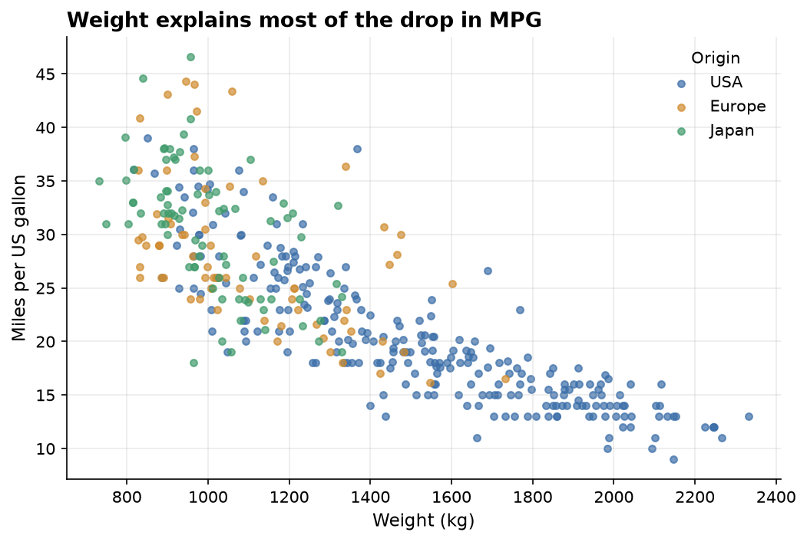
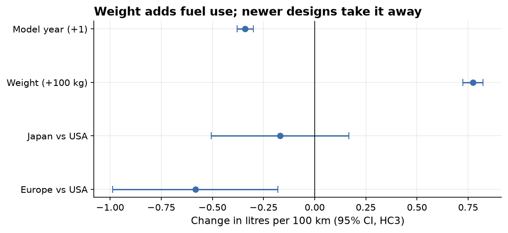
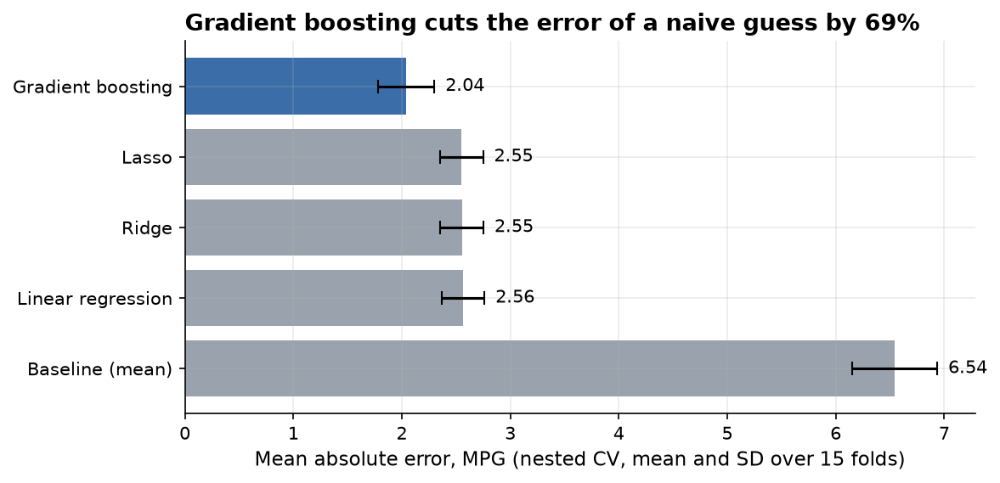
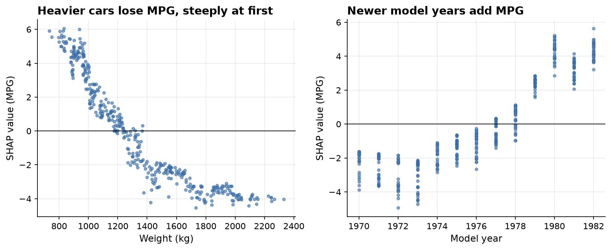
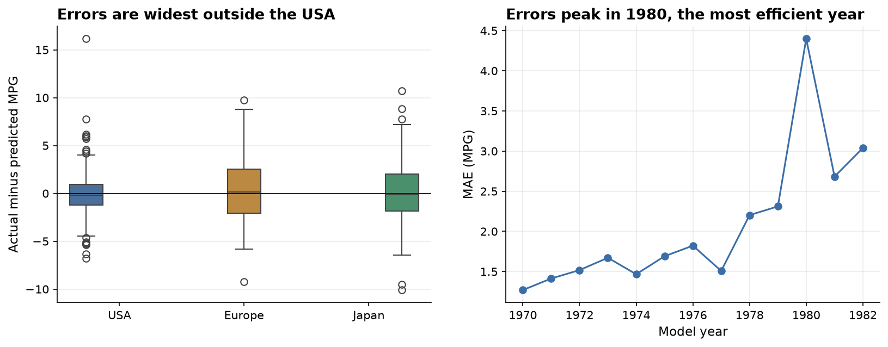

# What drives a car's fuel efficiency, and how well can we predict it?

[](https://github.com/LA-VS/fuel-efficiency-drivers/actions/workflows/ci.yml)

**Weight is the main driver: each extra 100 kg adds 0.77 litres per 100 km (95% CI 0.72 to 0.82), about 1.3 fewer MPG, holding model year and origin constant.**
**A tuned gradient boosting model predicts MPG to within 2.0 MPG on average, a 69% smaller error than a naive guess (6.5 MPG) and 0.5 MPG better than linear regression.**



## How to run it

Needs [uv](https://docs.astral.sh/uv/). Everything else, including Python 3.12, is installed by uv from the lock file.

```
git clone https://github.com/LA-VS/fuel-efficiency-drivers.git
cd fuel-efficiency-drivers
uv sync
uv run pytest
uv run jupyter nbconvert --execute --to notebook --inplace notebooks/fuel_efficiency.ipynb
```

The raw data file is committed in `data/raw/`. To download a fresh copy from UCI, run `uv run python scripts/fetch_data.py`.
Seeds are fixed, so the notebook reproduces every number on this page.

## Data

[UCI Auto MPG](https://archive.ics.uci.edu/dataset/9/auto+mpg): 398 cars, model years 1970 to 1982, with MPG, cylinders,
displacement, horsepower, weight, acceleration, model year, origin and name.
Quinlan, R. (1993). Auto MPG [Dataset]. UCI Machine Learning Repository. https://doi.org/10.24432/C5859H.
Licensed under [CC BY 4.0](https://creativecommons.org/licenses/by/4.0/).

Quirks handled in [`clean.py`](src/fuel_efficiency/clean.py), each covered by a test:

* `horsepower` has 6 missing values, stored as `?`. They are imputed with the training fold median inside the model pipeline, and dropped for the OLS fits.
* `origin` is coded 1, 2, 3. It is decoded to USA, Europe and Japan before encoding, with USA as the reference level.
* `name` mixes make and model, with misspellings ("vw", "vokswagen", "chevy", "chevroelt", "toyouta", "maxda"). The make is extracted and corrected.

## Method

The question has two halves, so the analysis has two parts. Both are in [the notebook](notebooks/fuel_efficiency.ipynb).

**Part A, why: inference with OLS**

* **Target choice.** Fuel consumption in litres per 100 km is close to linear in weight (R² 0.78) while MPG curves (R² 0.69).
  That fits the physics: fuel used scales with mass moved, and MPG is the reciprocal of fuel used. Part A models consumption.
* **Multicollinearity.** Displacement, cylinders and horsepower have VIFs of 9 to 20 and correlate above 0.84 with weight.
  Weight is kept as the single size measure, which brings every VIF down to about 1.3.
* **Model.** `l_per_100km ~ weight + model year + origin`, R² 0.88.
* **Diagnostics.** Residuals are close to normal, but Breusch Pagan rejects constant variance (p < 0.001), so the confidence intervals use HC3 robust standard errors.
  23 cars exceed the Cook's distance threshold of 4/n, mostly heavy 1970 trucks; removing them leaves the weight coefficient unchanged.



**Part B, how well: prediction with nested cross validation**

* Target is MPG, the number a reader wants predicted.
* Five models: a mean baseline, linear regression, Ridge, Lasso and `HistGradientBoostingRegressor`.
* Every learned step (imputation, scaling, one hot encoding) is inside an sklearn `Pipeline`, so it is fitted on training folds only.
* Ridge, Lasso and gradient boosting are tuned by a 5 fold grid search *inside* each outer fold. The outer loop is 5 fold cross validation repeated 3 times, giving 15 honest test scores per model.

| Model | MAE (MPG) | RMSE (MPG) |
|---|---|---|
| Gradient boosting | **2.04** ± 0.26 | **2.85** ± 0.36 |
| Lasso | 2.55 ± 0.20 | 3.35 ± 0.32 |
| Ridge | 2.55 ± 0.20 | 3.36 ± 0.33 |
| Linear regression | 2.56 ± 0.20 | 3.34 ± 0.30 |
| Baseline (training mean) | 6.54 ± 0.39 | 7.81 ± 0.49 |

Mean ± standard deviation across the 15 outer folds.



## Findings

1. **Weight dominates.** It is the largest effect in the OLS model and the largest SHAP contribution in the gradient boosting model.
2. **Newer cars were more efficient at the same weight.** Each model year cut consumption by 0.34 L/100 km, about 4 L/100 km across the period, in line with the push for fuel economy after the 1973 oil crisis.
3. **Origin matters much less than it first appears.** Japanese cars averaged 30.5 MPG against 20.1 for American cars, but they were also about 500 kg lighter.
   Once weight and year are held constant, the Japan effect is not distinguishable from zero. European cars keep a small advantage (0.58 L/100 km, 95% CI 0.18 to 0.99).
4. **The two parts agree.** The gradient boosting model was given every feature, and its SHAP values still rank weight and model year first.
   Its weight curve is steepest for light cars, which is the reciprocal shape that motivated the target choice in Part A.



5. **Where the model fails.** Error is highest for 1980 cars (the most efficient year) and for European and Japanese cars.
   The worst misses are engines the data cannot describe: diesels beat their prediction by 10 to 16 MPG, and Mazda's rotary engines fall short by about 10.



## What the original coursework got wrong, and what changed

| Original | This version |
|---|---|
| Features scaled on the full dataset before the train and test split, leaking test information | Imputation and scaling live in a `Pipeline`, fitted on training folds only |
| Duplicated cells run out of order (predict before fit) | One notebook that runs top to bottom, with logic in tested modules under `src/` |
| Absolute file path hard coded | Paths resolved from the repo root |
| One model, no baseline, no cross validation, no explanation | Mean baseline, four models, nested repeated cross validation, SHAP, and an inference model with diagnostics |

## Limitations

* **Small and old.** 398 cars from 1970 to 1982, most of them American. The findings describe that era's fleet, not modern cars, and certainly not hybrids or electric vehicles.
* **Missing features.** Fuel type (diesel or petrol), engine type (rotary), transmission and aerodynamics are not recorded, and they explain the largest errors.
* **Association, not causation.** The weight coefficient says heavier cars used more fuel, holding year and origin constant. It does not prove that taking weight out of a given car would save that exact amount, because weight also stands in for the engine size that goes with it.
* **Overlapping features in Part B.** SHAP credit is shared among weight, displacement, cylinders and horsepower because they carry the same information, so their individual SHAP values should not be read as separate causes.

## Next steps

* Add fuel type by parsing "diesel" from the car name, and test whether it closes the largest residuals.
* Model consumption (L/100 km) in Part B as well and back transform, to see whether the linear models catch up with gradient boosting.
* Check the conclusions on a modern dataset, such as the US EPA fuel economy data.

## Repo layout

```
data/raw/                 the UCI file, never edited by hand
src/fuel_efficiency/      data loading, cleaning, inference, models, chart style
notebooks/                the narrative notebook, outputs saved
reports/figures/          charts used in this README
tests/                    pytest for cleaning, inference and model logic
scripts/fetch_data.py     downloads the raw file from UCI
```

## Origin

This project began as coursework for my Level 4 Data Analyst apprenticeship and was rebuilt to a professional standard:
tested modules, a reproducible environment, validation free of leakage, and an analysis structured around one question.
